<div align="center">

# SwachhGrid

### येथे कचरा टाकू नये. Or report it.

**A live sanitation map for Nagpur's densest bastis.** Residents report in Marathi, Hindi or English in three taps. Crews get jobs ranked by how many people live beside the waste. A job closes only with an after-photo taken on the spot. Officers watch it all on a 3D map built from **1,35,721 real building footprints**.

`Next.js 16` · `React 19` · `MapLibre GL` · `deck.gl` · `Tailwind CSS 4` · `Zustand` · `Overture Maps` · `Open-Meteo`

[Landing](#the-four-surfaces) · [Demo script](docs/DEMO.md) · [Architecture](docs/ARCHITECTURE.md) · [Data](docs/DATA.md) · [Design system](docs/DESIGN-SYSTEM.md) · [Roadmap](docs/ROADMAP.md)

</div>

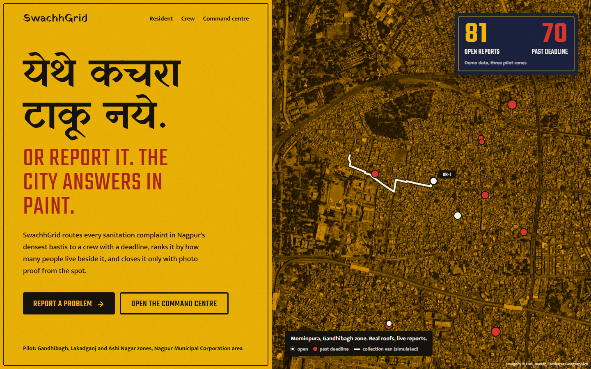

---

## The problem

> YCCE Hackathon · PPT round · Theme 03, Social Issues · **PS1: Urban Slum Sanitation and Waste Management Tracker**

Irregular garbage clearance, overflowing bins and blocked drains in dense urban pockets lead to vector-borne and waterborne outbreaks such as malaria and cholera. Nagpur has **426 slum settlements, 298 of them notified** (2024 press reports citing NMC). A 2016 NMC survey counted about **8.6 lakh slum residents**. Complaints today are scattered across calls, WhatsApp groups and ward offices. Nobody can see which homes are living next to waste that was reported a week ago.

## What SwachhGrid does differently

| | Typical complaint portal | SwachhGrid |
|---|---|---|
| **Map** | A pin on a generic street map | A 3D twin of the real neighbourhood: 1,35,721 building footprints, satellite imagery, real roads and rivers |
| **Priority** | First come, first served | **People exposed × days open × severity**: the dump beside 900 homes beats the one beside 40 |
| **Closing a ticket** | Officer clicks "resolved" | Crew must take an **after-photo within 50 m** of the report. The resident sees before/after and can **reopen** it |
| **Duplicates** | Ten complaints for one pile | A report within **30 m** of an open one becomes "me too" support |
| **Language** | English forms | **Marathi first**, Hindi, English; icon-led and large-type for low literacy |
| **Health** | Separate department | **Mosquito-breeding watch** per zone from old stagnant-water and drain reports plus live rainfall, and a **one-click alert** in Marathi to households within 300 m |
| **Collection** | Not tracked | **Collection vans on real roads**, lanes driven vs **skipped**, and "truck did not come" complaints **confirmed by route data** |
| **Accountability** | Status text | A **custody line** on every report (reported → assigned → work started → cleared with proof), **deadlines**, **escalation** and a **30-day replay** |

## The four surfaces

| Route | Who | What it is |
|---|---|---|
| [`/`](src/app/page.tsx) | Everyone, judges first | The signboard landing: live open and past-deadline tallies, the duotone satellite of Mominpura with live reports, the custody story, and the real top of the priority queue |
| [`/report`](src/components/ReportFlow.tsx) | Residents | Three-step report in Marathi / Hindi / English: pick a painted sign, take a photo, drop the pin. Duplicate detection, "my reports" with the custody line and a reopen button |
| [`/worker`](src/components/WorkerApp.tsx) | Sanitation crews | The duty board: jobs per zone ranked by people affected, navigate, start work, and **proof of clean** with a geofenced after-photo. The CLEARED / साफ stamp lands when the job closes |
| [`/command`](src/components/CommandCenter.tsx) | Zonal and health officers | The 3D command centre: exposure-tinted buildings, chronic-spot columns, priority queue, zone meters, breeding-risk watch, report detail with escalation, and a 30-day replay |

<table>
<tr>
<td width="62%">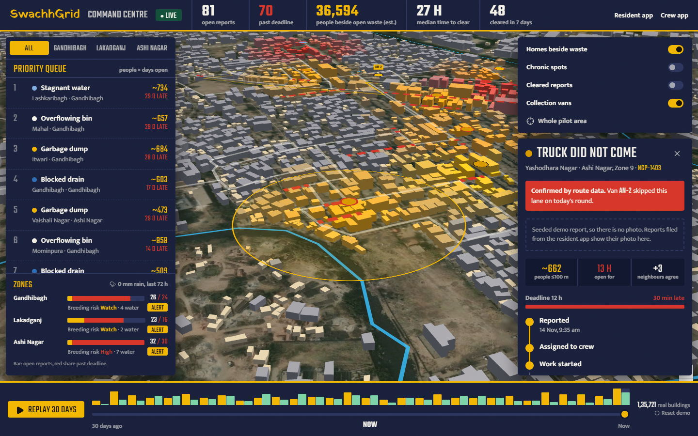</td>
<td>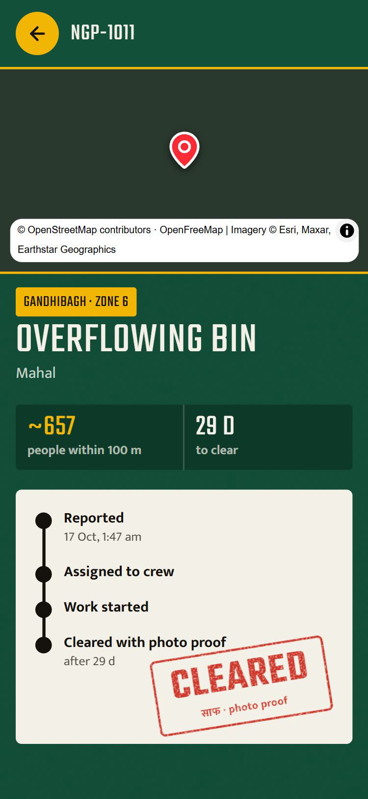</td>
</tr>
<tr>
<td colspan="2">
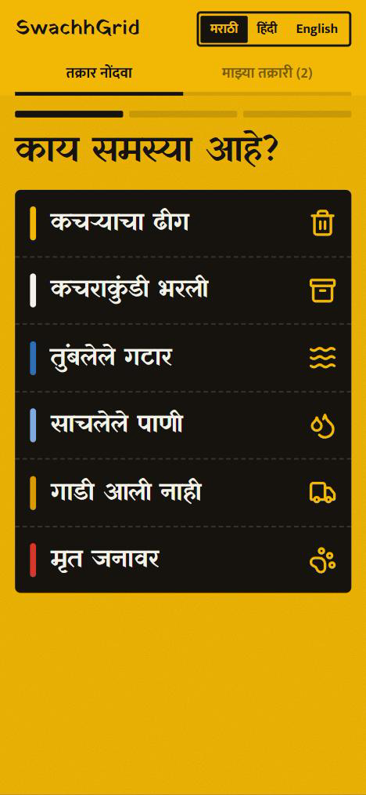
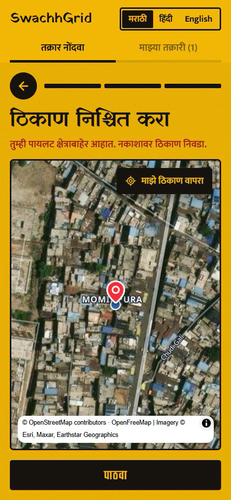
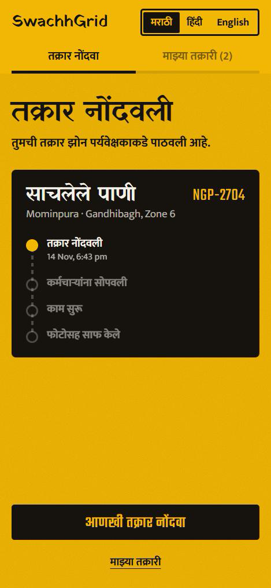
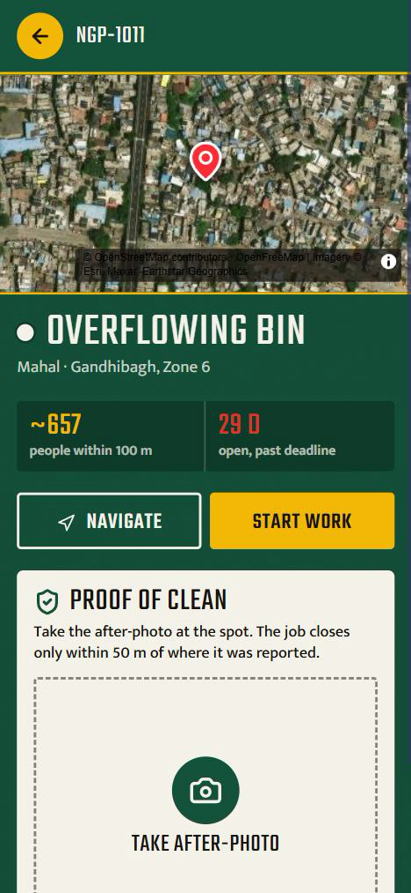
</td>
</tr>
</table>

## It moves

- **Ghanta gaadis on real roads.** Six collection vans drive Nagpur's actual lanes in 3D with fading trails. Lanes they skip turn into red dashes, and a "truck did not come" complaint beside one is marked *confirmed by route data*.
- **Run a live morning.** One button and the city starts working: reports drop in with ripples, neighbours back them, crews assign, start and clear jobs, and late jobs escalate. Every event lands in a live feed.
- **Health alert broadcast.** For a zone with high mosquito-breeding risk: households reached, the Marathi message, and waves spreading from every water spot when you press Send.
- **Your van, on the resident's phone.** "Your ghanta gaadi GB-1 arrives in about 7 minutes", from the same shared clock as the officer's map.
- **A 30-day timeline** of reports and clean-ups that you can click to time-travel.
- **Monsoon simulator.** Drag a rain slider from 0 to 150 mm and water rises in the low-lying lanes, from real elevation data. Blocked drains overflow into the homes around them, breeding risk climbs zone by zone, and the Alert buttons start to pulse.
- **Sun and night.** Buildings are lit from the real sun position over Nagpur at the scrubber's time. Replaying 30 days runs through day and night, and at night the open reports glow.
- **Then and now.** Drag a divider across the 3D city: the left side is the city 7, 14, 21 or 28 days ago, the right side is now. Reports open then and cleared since get a green ring.
- **Play tour.** A 70-second guided flight with captions for the projector: the city, the glowing homes, a van on its round, a complaint the route confirms, a cleared job, the monsoon, and the alert.

<table>
<tr>
<td width="50%">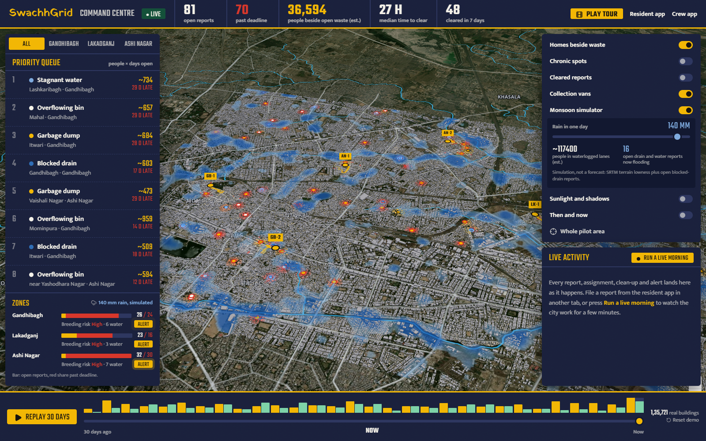</td>
<td width="50%">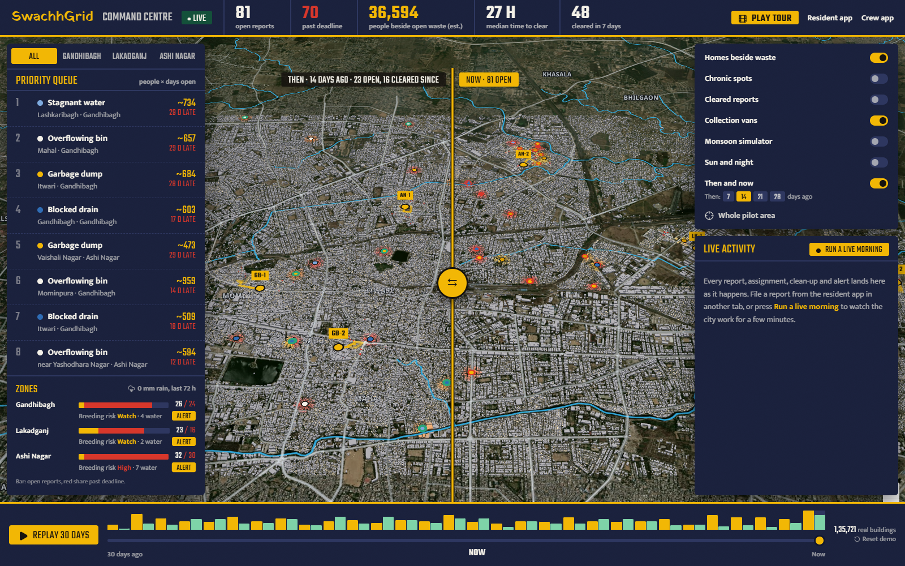</td>
</tr>
<tr>
<td>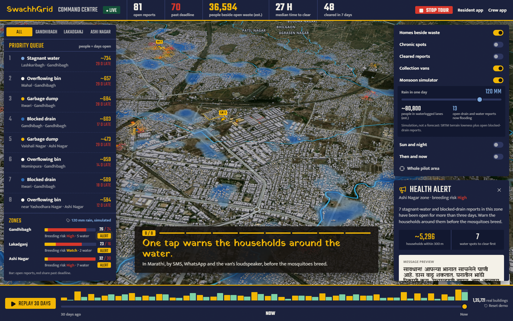</td>
<td>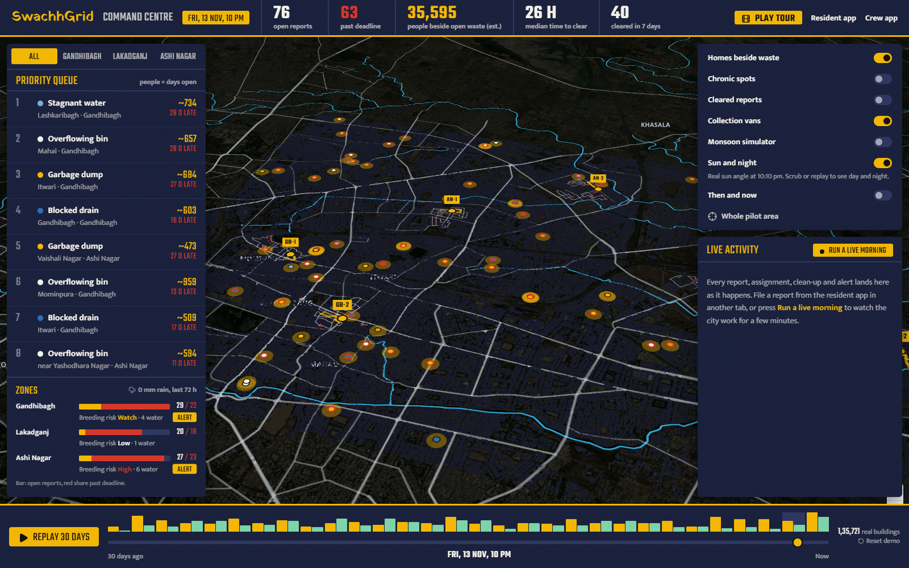</td>
</tr>
</table>

## It works where the problem is

- **Crew route of the day.** Each zone's crew gets its top jobs in the shortest order along real roads, routed over 31,133 OpenStreetMap junctions: "8 stops, 8.6 km, done by 10:23, ~5,500 people relieved", with a map, a stop list with arrival times, and one tap to start it in Google Maps. The command centre shows all three crews driving their routes.
- **Person-days of exposure avoided.** The impact figure: for every report cleared, the people within 100 m × the days saved against a 5-day baseline. It is on the landing page, in the command-centre header and on every scorecard.
- **Public zone scorecards.** `/ward/gandhibagh`, `/ward/lakadganj` and `/ward/ashinagar` show person-days avoided, the people still waiting, median time to clear, the share cleared within deadline, 30 days of reports and clean-ups, what is open and what is most urgent. Each can be printed for the zonal review or shared as an image.
- **Speak the problem.** Press **बोलून सांगा** ("say it") and say "इथे गटार तुंबले आहे" ("the drain here is blocked"). The app picks Blocked drain and keeps the words as the report's note. It understands Marathi, Hindi, English and romanised phrases. Every step has a speaker button that reads it aloud, and phones without speech recognition get a type-it box with the same matcher.
- **Works without network.** The app installs to the home screen and its pages, data and the map tiles a resident has viewed stay cached. A report filed with no signal is saved on the phone ("फोनवर जतन केली", saved on your phone) and sent by itself when the network returns.

<table>
<tr>
<td width="50%">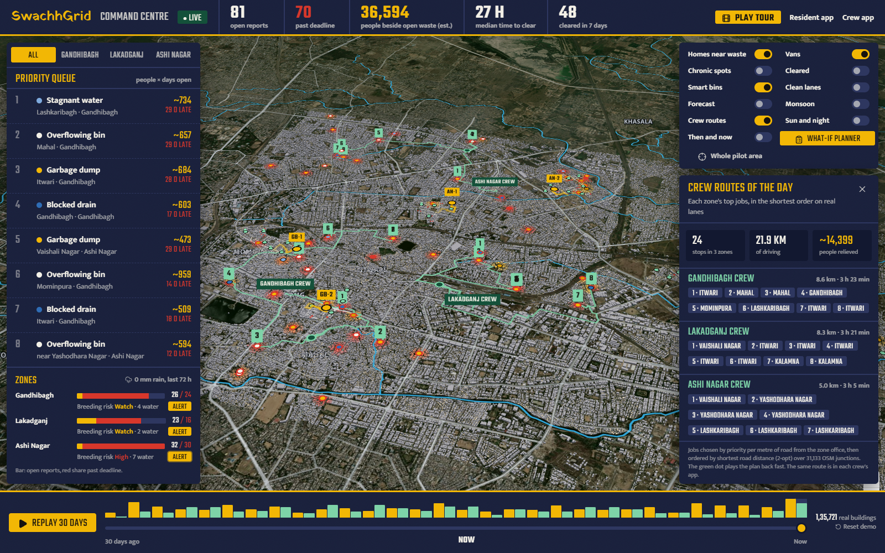</td>
<td width="50%">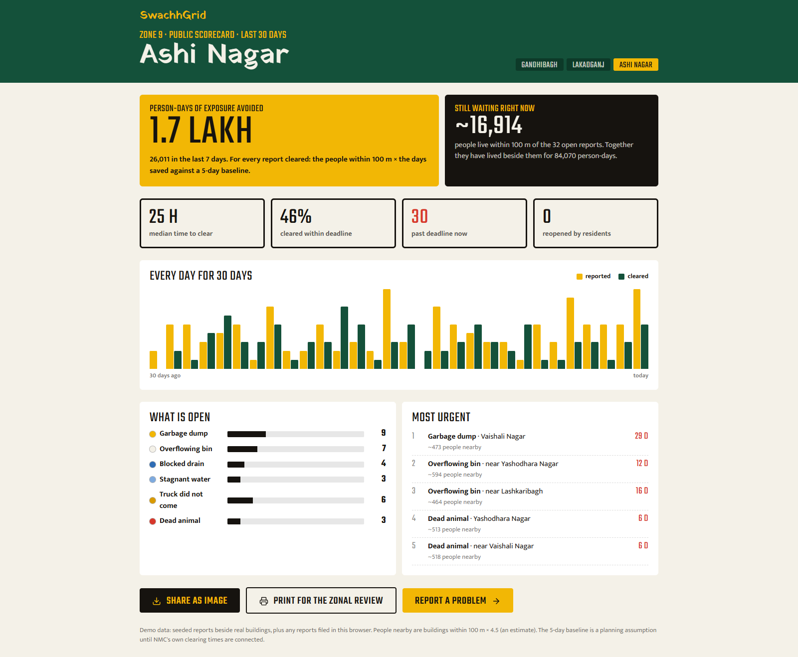</td>
</tr>
</table>
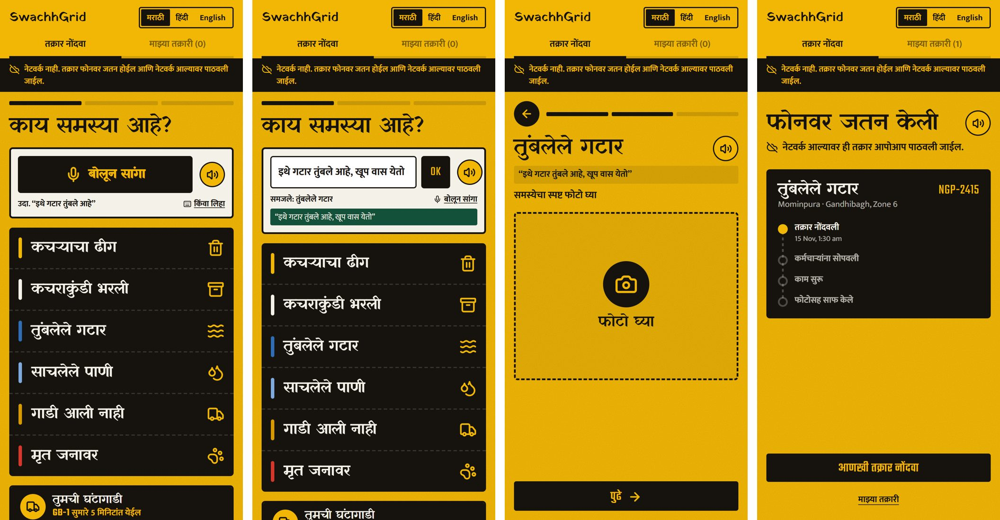

## It plans

The map also tells the city what to do next, not only what went wrong.

- **What-if planner.** Opens on the spot where a new community bin would catch the most dumping that no bin covers today, and shows the homes newly within 100 m and the expected drop in reports. Drag the bin anywhere to compare. Switch to **Extra van shift** to see the lanes a van skipped today light up green, with the people along them and the "truck did not come" reports the shift would answer.
- **Smart-bin twins.** 37 community bins stand on the map as 3D cylinders that fill between van visits. Every bin has a QR sticker (`/bins` prints the sheet). A resident scans it and says "full" in one tap on `/bin?id=…`. The bin turns red, a report enters the queue, and a dashed line nudges the nearest van towards it.
- **Clean-lane ribbons.** Every lane with a complaint in the last 30 days is painted from red (open) through amber to green at 7, 14 and 21 days without a new one. Click a lane for its streak and a shareable "आमची गल्ली स्वच्छ · our lane, clean" card for the mohalla's WhatsApp group.
- **Next week's hotspots.** A forecast layer raises bars where dumping is likely to come back next week, from repeat history, skipped van lanes and rain, with a ranked list naming the strongest driver for each spot.

<table>
<tr>
<td width="50%">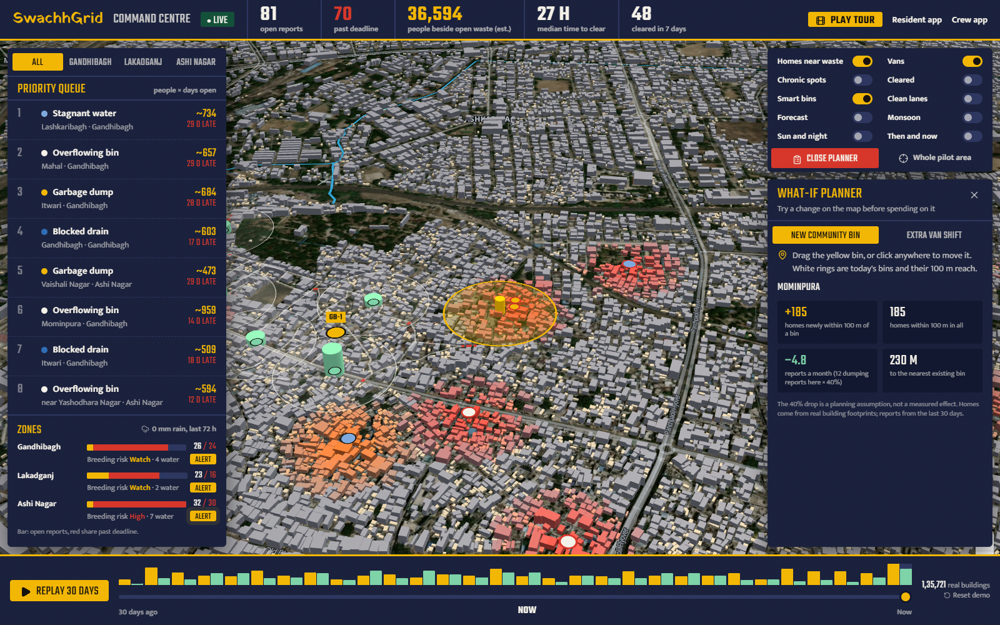</td>
<td width="50%">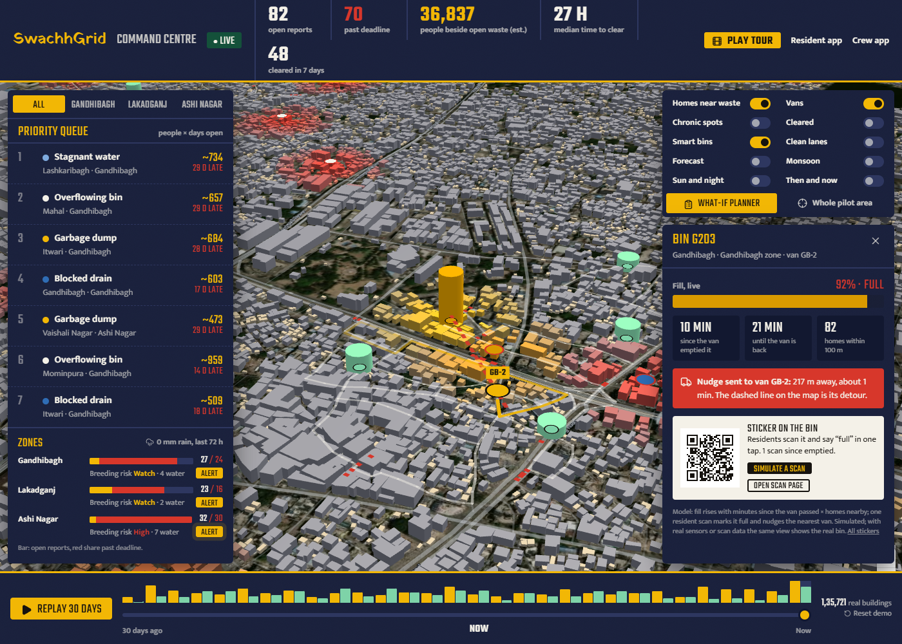</td>
</tr>
<tr>
<td>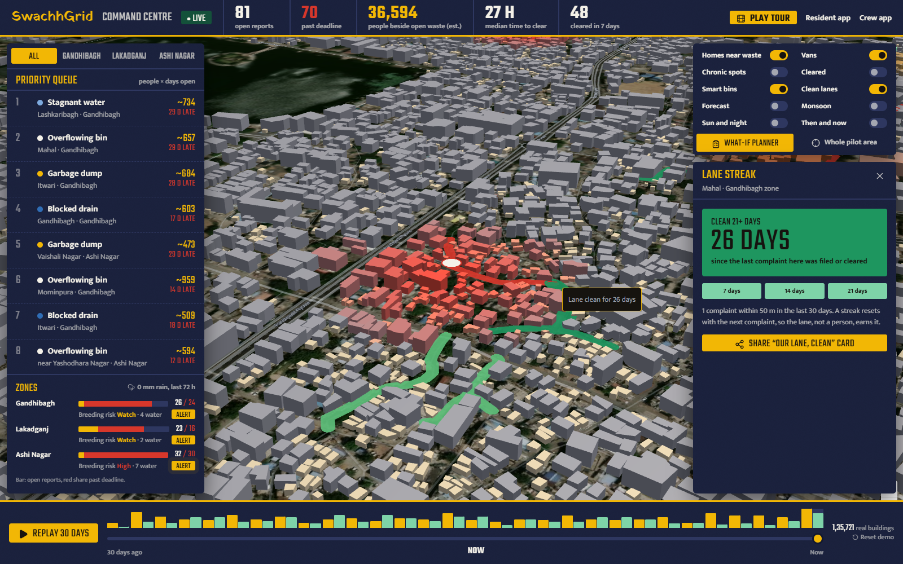</td>
<td>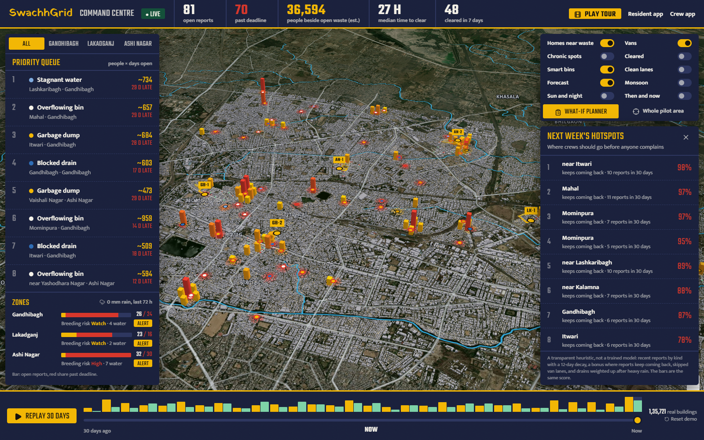</td>
</tr>
</table>

Details for each are in [docs/FEATURES.md](docs/FEATURES.md#moving-parts-what-makes-the-demo-alive). The vans are simulated on real roads, because no live van GPS is public.

## Try the whole loop in 90 seconds

1. Open **`/report`** on your phone. Pick **तुंबलेले गटार** (blocked drain), skip or take a photo, drag the map so the pin sits on a lane in Mominpura, press **पाठवा**.
2. Open **`/command`** on a laptop in the same browser. The count rises, the new report sits in the queue, and the homes around it glow amber.
3. Click it. The camera flies down to the lane. Press **Assign**, then **Open in crew app**.
4. In **`/worker`**, take the after-photo. Away from the spot, the job refuses to close; tick the demo override. Press **Close job**: the stamp lands.
5. Back in `/report`, **My reports** shows before and after, with **Not cleaned** to reopen.
6. In `/command`, press **Replay 30 days** and watch hotspots grow and clear.

The full judge walkthrough, with talking points, is in [docs/DEMO.md](docs/DEMO.md).

> **Demo data, honestly labelled.** The 330 existing reports are seeded beside real small buildings in the densest clusters and carry no photos. Reports you file are stored in your browser and sync across tabs, not across devices; a shared database is the first item on the [roadmap](docs/ROADMAP.md). Zone areas are approximate, building heights are estimated from footprint size, and "people exposed" assumes 4.5 residents per building.

## Pilot area

Three NMC zones, chosen from the data: **Gandhibagh (Zone 6)**, **Lakadganj (Zone 8)** and **Ashi Nagar (Zone 9)**. They cover the old-city cores of Mominpura, Itwari and Mahal, and the dense eastern edge towards Kalamna and Pardi. Ashi Nagar had the most slums of any zone in NMC's 2016 survey (63). The densest small-building clusters in the Overture data fall inside these zones. Details are in [docs/DATA.md](docs/DATA.md).

## How it works

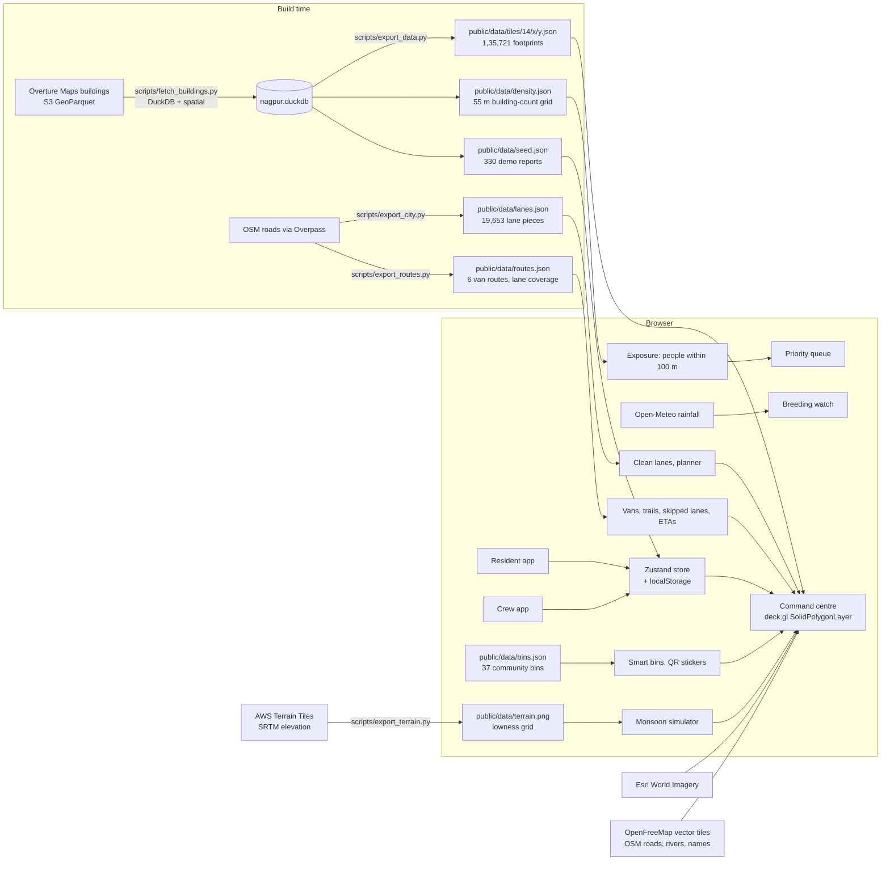

**Priority** = (people within 100 m + 20) × days open × (0.6 + 0.4 × severity) × (1 + 0.1 × neighbours agreeing). **People within 100 m** = buildings in the 55 m density cells whose centres fall inside the radius × 4.5. The full model and its assumptions are in [docs/ARCHITECTURE.md](docs/ARCHITECTURE.md#the-models).

## Run it

```bash
npm install
```

```bash
npm run dev
```

Open http://localhost:3000. `npm install` also copies MapLibre's worker into `public/maplibre` (see [`scripts/copy-maplibre.mjs`](scripts/copy-maplibre.mjs)). No API keys are needed: every map and data source is open.

To deploy, import the repository into Vercel with the default Next.js settings. Every route is statically prerendered.

To rebuild the map data from scratch (about 2 minutes, needs Python 3.11):

```bash
pip install --target .pylib duckdb
```

```bash
python scripts/fetch_buildings.py .pylib nagpur.duckdb
```

```bash
python scripts/export_data.py .pylib nagpur.duckdb public/data
```

## Project map

```
src/
  app/                 routes: / (landing), /report, /worker, /command, /bin, /bins, /ward/[zone], manifest
  components/
    CommandCenter.tsx  3D map, queue, zone meters, detail, replay
    ReportFlow.tsx     resident three-step report, duplicates, my reports
    WorkerApp.tsx      crew duty board and proof of clean
    LandingLive.tsx    duotone hero map, live tally, top of queue
    CommandPanels.tsx  live activity feed, van detail, health alert, timeline
    VanCards.tsx       resident van ETA and crew van rounds
    CityPanels.tsx     bin, lane streak, planner and forecast panels
    BinPages.tsx       /bin scan page and /bins printable sticker sheet
    CrewRoute.tsx      crew app "Today's route" card
    WardScorecard.tsx  /ward/[zone] public scorecard
    VoiceBar.tsx       speak-the-problem bar and read-aloud buttons
    paint.tsx          Stamp and CustodyLine, the shared signature components
    MiniMap.tsx        drag-the-map pin picker
  lib/
    domain.ts          categories, deadlines, zones, exposure and priority models
    store.ts           Zustand store, activity feed, localStorage persistence, cross-tab sync
    vans.ts            van routes, shared clock, ETAs, skipped-lane checks
    flood.ts           monsoon simulator: terrain lowness, drain boost, water depth
    city.ts            smart bins, lane streaks, what-if planner, hotspot forecast
    qr.ts              dependency-free QR encoder for bin stickers
    roads.ts           road graph from OSM lanes, Dijkstra, crew route of the day
    impact.ts          person-days avoided and zone scorecard statistics
    voice.ts           speech input, read-aloud, Marathi/Hindi/English problem matcher
    sun.ts             sun altitude for day and night lighting
    simulate.ts        "live morning" event simulation
    buildings.ts       building tile loader and height estimate
    mapStyle.ts        satellite + OSM style
    i18n.ts            Marathi, Hindi, English strings
scripts/               data pipeline (DuckDB) and MapLibre worker copy
public/sw.js           offline service worker
public/data/           exported building tiles, density grid, seeded reports
docs/                  architecture, data, design system, demo script, roadmap
```

## Documentation

| Doc | What is in it |
|---|---|
| [PRODUCT.md](PRODUCT.md) | Product truth: users, purpose, positioning, constraints, principles |
| [docs/ARCHITECTURE.md](docs/ARCHITECTURE.md) | Stack, data flow, state, every model with its formula and assumptions, performance notes |
| [docs/DATA.md](docs/DATA.md) | Every dataset, licence, how the pilot zones were chosen, what is real vs estimated vs seeded |
| [docs/FEATURES.md](docs/FEATURES.md) | Every feature mapped to the problem statement, by role, with its file |
| [docs/DESIGN-SYSTEM.md](docs/DESIGN-SYSTEM.md) | The Painted Notice visual language: palette, type, components, motion, accessibility |
| [docs/DEMO.md](docs/DEMO.md) | A timed walkthrough for judges and the questions to expect |
| [docs/ROADMAP.md](docs/ROADMAP.md) | What to build next, ranked by impact for the competition and for real use |

## Credits and licences

Buildings © [Overture Maps Foundation](https://overturemaps.org) (Google Open Buildings, Microsoft ML Buildings, OpenStreetMap), ODbL / CDLA. Imagery © Esri, Maxar, Earthstar Geographics. Roads, rivers and place names © OpenStreetMap contributors via [OpenFreeMap](https://openfreemap.org). Rainfall from [Open-Meteo](https://open-meteo.com). Elevation from [AWS Terrain Tiles](https://registry.opendata.aws/terrain-tiles/) (SRTM / NASADEM). Fonts: Yatra One, Teko and Mukta (SIL Open Font License).

SwachhGrid is an independent civic project built for the YCCE Hackathon. It is not affiliated with Nagpur Municipal Corporation or Swachh Bharat Mission.
