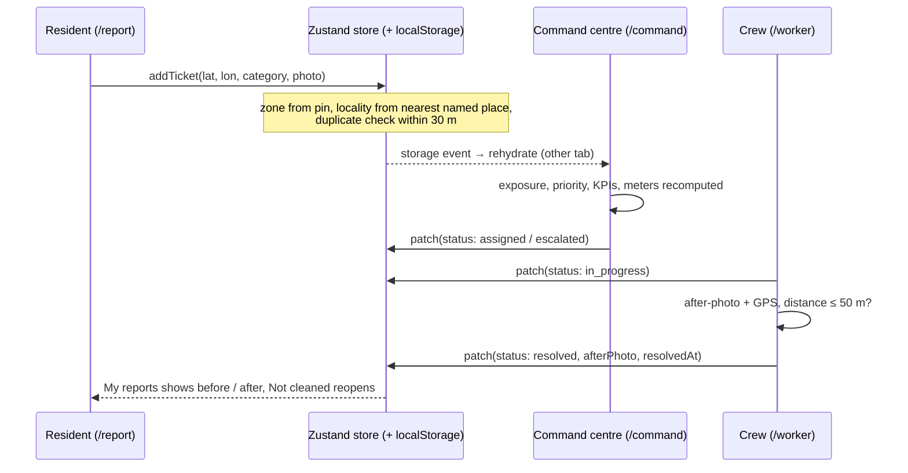

# Architecture

SwachhGrid is a statically prerendered Next.js 16 app. All map rendering, state and models run in the browser. There is no server and no API key: every external source is an open tile or JSON endpoint. That is why it deploys to Vercel as-is and why the demo works from a link.

## Stack

| Layer | Choice | Why |
|---|---|---|
| Framework | Next.js 16 (App Router, Turbopack), React 19, TypeScript | Static export of every route, fast Vercel deploys |
| Styling | Tailwind CSS 4 with `@theme` tokens in [`globals.css`](../src/app/globals.css) | One token set for four very different surfaces |
| Base map | MapLibre GL 6 | Open-source WebGL map, no key, works with any tile source |
| 3D layers | deck.gl 9 (`SolidPolygonLayer`, `HexagonLayer`, `ScatterplotLayer`) through `@deck.gl/mapbox` `MapboxOverlay` | Extrudes 1,35,721 polygons at interactive frame rates, per-building colour updates |
| State | Zustand with `persist` middleware | Tiny, works outside React, localStorage persistence |
| Icons | lucide-react | One consistent stroke family |
| Fonts | `next/font/google`: Yatra One, Teko, Mukta | Self-hosted at build, all three cover Devanagari |
| Data pipeline | Python + DuckDB (`spatial`, `httpfs`) | Reads Overture's GeoParquet straight from S3 with a bounding-box filter |

## Routes and components

```
/            src/app/page.tsx        server component; live parts load client-only
             └ LandingLive.tsx       HeroMap (image tiles + SVG duotone), Tally, TopQueue
/report      ReportFlow.tsx          resident flow, uses MiniMap
/worker      WorkerApp.tsx           crew duty board and Job detail, uses MiniMap
/command     CommandCenter.tsx       MapLibre + deck.gl overlay, queue, meters, detail, replay
shared       paint.tsx               Stamp, CustodyLine, CAT_PAINT
             ClientOnly.tsx          next/dynamic wrappers with ssr:false
```

Every interactive surface is loaded with `next/dynamic({ ssr: false })` from [`ClientOnly.tsx`](../src/components/ClientOnly.tsx), because MapLibre, deck.gl, `localStorage` and geolocation exist only in the browser. The landing page keeps its static copy server-rendered, so the first paint is instant and only the live map, tally and queue hydrate.

## Data flow



### The store

[`src/lib/store.ts`](../src/lib/store.ts) holds three things:

- `seed`: the 330 demo reports from `/data/seed.json`, hydrated relative to the current time so they always look recent.
- `userTickets`: reports the visitor filed.
- `patches`: changes the visitor made to seeded reports (assign, escalate, resolve, reopen, me-too), stored as diffs so the seed file never changes.

`selectTickets` merges the three with a memo keyed on object identity, so React re-renders only when something actually changed. `persist` writes `userTickets` and `patches` to `localStorage` under `swachhgrid-demo-v1`. A `storage` event listener rehydrates other tabs, which is what makes the resident → command centre → crew loop work live across tabs in one browser.

Swapping the store for a hosted database (Supabase / Postgres + PostGIS, realtime channel) changes only this module. See [ROADMAP.md](ROADMAP.md).

### Map data

[`scripts/export_data.py`](../scripts/export_data.py) writes three static files:

| File | Shape | Used for |
|---|---|---|
| `public/data/tiles/14/{x}/{y}.json` | `[[area_m2, [lon, lat, lon, lat, ...]], ...]` per zoom-14 tile, 20 tiles | Building extrusion in the command centre |
| `public/data/density.json` | `{lat0, lon0, cell: 0.0005, counts: {"i_j": n}}` | Exposure lookups without loading polygons |
| `public/data/seed.json` | `[{id, lat, lon, cat, sev, ageH, resolvedAgoH, meToo}]` | Demo reports |

[`useBuildingTiles`](../src/lib/buildings.ts) fetches the 20 tiles in parallel and adds each as its own deck.gl layer as it arrives, so the city fills in progressively instead of waiting for 14 MB.

## The models

All in [`src/lib/domain.ts`](../src/lib/domain.ts).

### People exposed

```
buildingsWithin(lat, lon, 100 m) = Σ counts of 55 m density cells whose centre is ≤ 100 m away
peopleExposed = round(buildingsWithin × 4.5)
```

4.5 residents per building is a planning assumption (Indian urban household size is about 4.4; slum footprints are mostly single-household). It is labelled as an estimate everywhere it appears. The command-centre total de-duplicates cells, so two reports in the same lane do not double-count homes.

### Priority

```
priority = (peopleExposed + 20) × max(0.25, daysOpen) × (0.6 + 0.4 × severity) × (1 + 0.1 × neighboursAgreeing)
```

- `+ 20` keeps a report in an empty plot from scoring zero.
- `max(0.25, …)` gives a fresh report a minimum weight of six hours.
- Severity is 1–3. Each "me too" adds 10 %.

### Deadlines and escalation

Product defaults, not NMC policy: overflowing bin, missed collection and dead animal 12 h; garbage dump 24 h; blocked drain and stagnant water 48 h. A report past its deadline turns red everywhere, gets a white ring on the map, and can be escalated to the Zonal Officer from the command centre.

### Exposure tinting

For each building, the nearest open report within 100 m sets a heat `w = 1 − d / 130`. The hot colour moves from chrome yellow on day 0 to vermilion by day 3. Reports are bucketed in a 0.001° grid so each building checks only its 3 × 3 neighbourhood: about 1.2 million distance checks per recolour instead of 9 million.

### Mosquito-breeding watch

Per zone: count open stagnant-water and blocked-drain reports older than 72 h. **High** at 6 or more, or 3 or more if the last 72 h of rainfall in Nagpur (Open-Meteo) is at least 5 mm. **Watch** at 2 or more. This is a triage signal, not an epidemiological model.

### Geofenced proof

The crew app reads the device GPS when the after-photo is taken. Within 50 m of the report, **Close job** unlocks. Outside it, the app states the distance and keeps the job open. A clearly labelled "Demo only: pretend I am on the spot" checkbox exists so judges can finish the loop from a desk.

### Duplicates

A new report of the same category within 30 m of an open one shows that report first and offers **मलाही हीच समस्या** (me too) instead of filing a duplicate.

### Zone routing

`zoneFor(lat, lon)` assigns one of three pilot zones from approximate rectangles. NMC publishes its 2025 ward (prabhag) boundaries only as PDF maps; tracing them is on the roadmap.

### Collection vans

[`scripts/export_routes.py`](../scripts/export_routes.py) builds a graph from about 8,600 real OpenStreetMap road segments in the pilot box and drives six vans (two per zone) around 6.2 km beats centred on dense localities. Each step prefers lanes not yet driven, stays within 650 m of the beat centre, and skips about one in seven fresh lanes; the skipped lanes are recorded. The output is `public/data/routes.json` (80 KB): paths with cumulative distance, plus 846 driven and 64 skipped lanes. It also seeds 12 "truck did not come" reports beside skipped lanes so the cross-check has matches.

In the browser, [`vans.ts`](../src/lib/vans.ts) places every van from one formula of wall-clock time: `distance = (now × 12 km/h × 20 + index × 1.7 km) mod round length`. Because the clock is shared, the van on the officer's map, the resident's ETA and the crew's round progress all agree without a server. `nextVan` finds the soonest van whose route passes within 160 m of a point and turns the distance along its loop into real minutes.

### The animation loop

Static layers (135k buildings, lanes, report dots, columns) are rebuilt only when their data changes and are kept in a ref. A separate `requestAnimationFrame` loop at about 30 fps appends the moving layers (van trails as deck.gl `TripsLayer`, van heads and labels, ripples for new reports, clean-up pulses and alert waves) and calls `overlay.setProps`. React never re-renders for animation, so the queue and panels stay responsive.

### Live activity and simulation

The store keeps a `feed` of events. `addTicket`, `patch` (status changes, escalation) and `meToo` log events automatically, so actions from the resident or crew app in another tab appear in the officer's feed. [`simulate.ts`](../src/lib/simulate.ts) runs a "live morning": every 3.2 s it files a report beside an existing one (so it lands in a real dense lane), adds a neighbour's support, or assigns, starts, escalates or clears a job. Simulated reports are tagged `source: "sim"` and never persisted.

### Health alerts

Households reached = buildings in density cells within 300 m of the zone's old water reports, de-duplicated. Sending logs an alert event and animates three-ring waves from each water spot for nine seconds. Nothing is actually sent in the demo.

### Monsoon simulator

A transparent waterlogging model, not a hydraulic one. [`scripts/export_terrain.py`](../scripts/export_terrain.py) reads AWS Terrain Tiles (SRTM / NASADEM, about 30 m) for the pilot box and resamples them to a 0.00025° grid (about 27 m, 360 × 220 cells). For each cell:

```
lowness  = mean elevation within ~450 m − elevation        (smoothed twice with a 5 × 5 box)
boost    = up to 1.4 m × (1 − d / 150 m) near each open blocked-drain or stagnant-water report
level(R) = 3.3 m − 2.3 m × (R / 150)^0.8                   (R = rain in mm)
depth    = lowness + boost − level(R), water where depth > 0
```

Light rain fills only the deepest hollows; heavy rain spreads along the low corridors (the Nag river's course shows up on its own); every choked drain puts water into the lanes around it. The grid ships as an 8-bit PNG (37 KB). [`flood.ts`](../src/lib/flood.ts) paints the water into a canvas drawn with a deck.gl `BitmapLayer` whose opacity shimmers in the animation loop. While the simulator is on, its rainfall replaces the live Open-Meteo figure in the breeding-risk rule, and any drain or water report standing in water counts as a water report regardless of age. People in waterlogged lanes = buildings in density cells with more than 10 cm of water × 4.5. It is labelled as a simulation, not a forecast.

### Sun and night

[`sun.ts`](../src/lib/sun.ts) computes the sun's altitude for Nagpur at the scrubber's time (standard low-precision solar position). A deck.gl `SunLight` lights the building walls from the real sun direction; ambient light, its colour and the satellite brightness fall with a daylight factor that ramps through dawn and dusk. At night open reports get a soft glow. deck.gl's cast shadows are experimental and drew artifacts over this many buildings, so they are off.

### Then and now

The building tiles and report dots are drawn twice: once for now and once for the chosen earlier time, each with its own exposure tint. deck.gl's `ClipExtension` clips the "then" layers west of a meridian and the "now" layers east of it. The divider follows that meridian through the 3D camera (projected top and bottom points), so it stays correct when the map is tilted; dragging it sets the meridian from the pointer.

### Tour

`runTour` is an async script: `flyTo` with an await on `moveend`, timed captions, and the same state setters a person would use (select a report, open the van panel, turn on the simulator and raise the rain). During the van scene the animation loop moves the camera with the van. A token makes Stop end it at any point.

## Time travel

The command centre's scrubber sets a virtual time `at` anywhere in the last 30 days. Every model takes `at` as input (`isOpenAt`, `ageHours`, `isOverdue`, `priority`), so the map, queue, KPIs, meters and tinting all show the city as it was at that moment. Replay advances `at` by six hours every 140 ms.

## Performance notes

- Building tiles stream in parallel; each is a separate layer so recolouring one does not rebuild the others.
- `updateTriggers` limit recolouring to changes in the risk index or the exposure toggle.
- The landing hero uses plain `` satellite tiles under an SVG duotone filter instead of a WebGL map: no GPU context, fast first paint, and the filter applies reliably.
- MapLibre's worker is served from `/public/maplibre` (copied at `postinstall`) because Turbopack does not bundle it.
- Photos are downscaled in the browser to 720 px JPEG at quality 0.62 (about 40–80 KB) before they are stored.

## Known limits

- Reports sync only between tabs of one browser until a database is added.
- Zone boundaries are approximate rectangles.
- Building heights are estimated from footprint area (under 45 m² ≈ one storey).
- Seeded reports have no photos.
- SMS and WhatsApp notifications are not implemented; the alert broadcast is a demo.
- Van positions are simulated on real roads; lane coverage comes from the simulation, not real GPS.
- The monsoon simulator uses 30 m terrain and a simple ponding rule; it shows where water collects first, not depths to trust.
